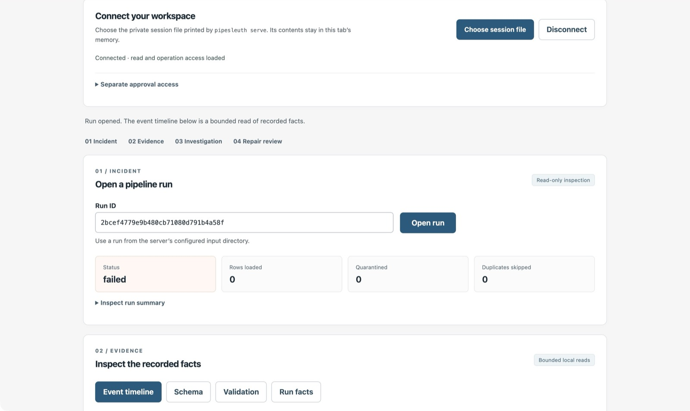
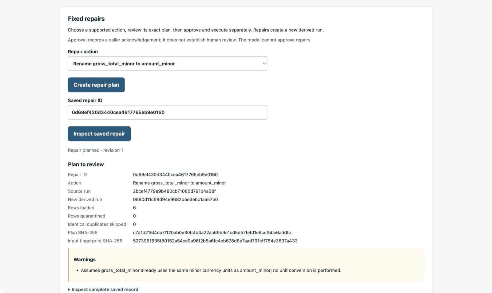

# Five-minute local demo

A pipeline import failed after an upstream column was renamed. Use PipeSleuth
to see why it failed, decide whether the fixed repair applies, and check the
new database. The walkthrough uses synthetic orders and needs no model.

1. Follow [Getting started](../README.md#getting-started) to install the API
   dependencies and start the local server.
2. In a second terminal, create the incident:

   ```sh
   PYTHONPATH=src .venv/bin/python -m pipesleuth pipeline run --scenario schema_drift
   ```

   A failed load is expected. Copy its `run_id` from the output.
3. Open the server URL, select the private session file and open that run. In
   **Evidence**, inspect the failed load event and the observed and required
   schemas. Run the deterministic checklist in **Investigation** and inspect
   the evidence references behind its finding.
4. In **Fixed repairs**, plan the amount-column rename. Compare the source and
   target run IDs and read the warning: renaming assumes the values already use
   the same currency units. Load approval access, acknowledge the exact plan
   and approve it. Execution is a separate action.
5. Check the verification receipt. Inspect the derived run using its new ID:

   ```sh
   PYTHONPATH=src .venv/bin/python -m pipesleuth pipeline show DERIVED_RUN_ID \
     --data-dir var/repaired
   ```

   The failed source run stays in the input directory. Disconnect and stop the
   server with Ctrl-C when finished.

For an interview, explain why the application separates diagnosis, plan review,
approval, execution and verification. The browser demonstration shows that
workflow on synthetic data. The [matched evaluation](EVALUATION.md) measures the
experimental model separately and includes its failures.

## Desktop captures

These views come from the live 2 November Chrome run recorded in the
[UI audit](../reports/ui-smoke.json). They were exported on 3 November
with the browser toolbar cropped out. The run and repair IDs belong to
the synthetic demo.




